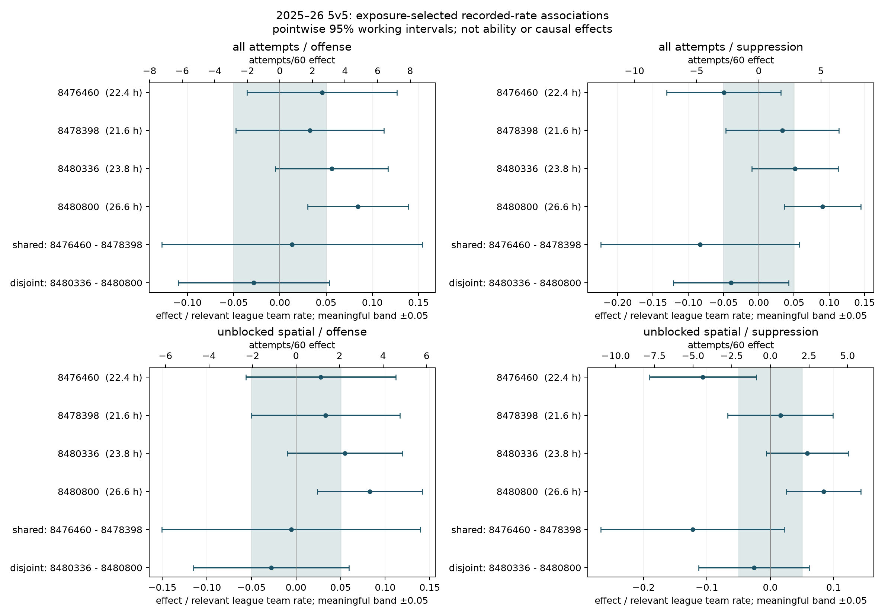
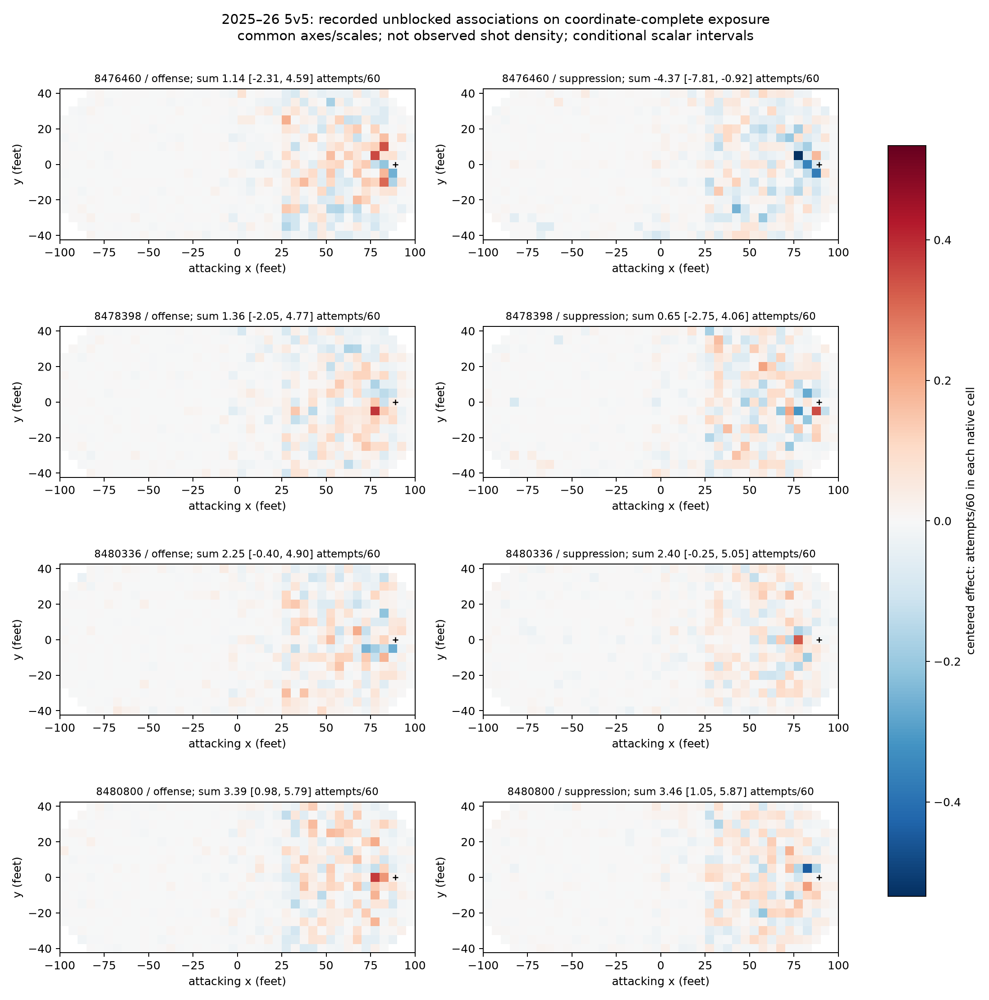
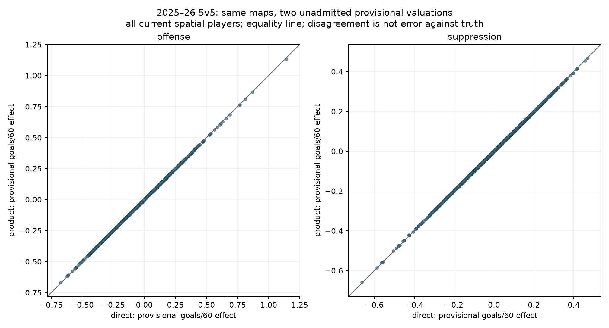

# 04a attribution feasibility

the specified research is complete. both populations are usable on their explicitly retained exposure, but most meaningful player differences remain unresolved. synthetic recovery and native negative predictions limit stronger claims. location unit stresses move provisional goal-rate effects more than switching these two valuation models. no player ability, chance model or publication handoff is admitted.

## population usability

both recorded-rate populations can be constructed for all five seasons. the inventory contains 1,312 games each year, but unresolved membership and one unknown overtime horizon prevent a complete-exposure claim. positive supported zero-event time remains; each population removes affected counts and exposure together in both team directions. the spatial target is recorded unblocked rates on coordinate-complete admitted exposure, not full-season unblocked rates.

| season | retained recorded attempts, all / spatial | retained physical seconds, all / spatial | known masked seconds, all / spatial | unresolved membership seconds |
|---|---:|---:|---:|---:|
| 2021–22 | 115,206 / 87,100 | 3,759,258 / 3,758,950 | 14,549 / 14,857 | 69,299 |
| 2022–23 | 118,666 / 87,948 | 3,773,938 / 3,773,938 | 5,078 / 5,078 | 27,075 |
| 2023–24 | 121,903 / 86,772 | 3,704,534 / 3,703,390 | 5,092 / 6,236 | 128,655 |
| 2024–25 | 118,465 / 84,079 | 3,658,546 / 3,658,499 | 2,890 / 2,937 | 260,095 |
| 2025–26 | 119,439 / 86,237 | 3,787,983 / 3,787,959 | 3,036 / 3,060 | 57,215 |

the two attacking directions double these physical seconds into team exposure. known masked seconds are established 5v5 time withheld by the paired masks; unresolved membership seconds are not established 5v5 time and remain separate. the unknown overtime horizon is not converted into an invented duration. no percentage here claims full coverage or missing-at-random selection. the complete game, team and player ledgers retain local reasons and unknown quantities.

the final-season pairs were frozen before fitting: `(8476460,8478398)` has the greatest shared scalar exposure, 72,948 seconds; `(8480336,8480800)` has zero shared exposure and the greatest combined exposure, 181,221 seconds. outcomes played no part in either selection.

## meaningful resolution under the working model

both corrected annual chains completed, with all ten scale selections resolved. the final season contains 940 observed players per population, plus 537 carried-only historical players. the all-attempt league team rate is `56.756` attempts/60; the coordinate-complete unblocked rate is `40.979`. their meaningful differences are therefore `2.838` and `2.049` attempts/60 respectively. these are different recorded populations and references.

each row below covers all 940 current players, with no exposure cutoff. positive suppression means fewer opponent attempts. labels use pointwise conditional intervals and the predeclared relative band `±.05`; they are not simultaneous discoveries or evidence of repeatable ability.

| population / role | meaningful positive | meaningful negative | within band | unresolved |
|---|---:|---:|---:|---:|
| all attempts / offense | 43 | 44 | 0 | 853 |
| all attempts / suppression | 7 | 19 | 0 | 914 |
| unblocked spatial / offense | 35 | 28 | 0 | 877 |
| unblocked spatial / suppression | 3 | 9 | 0 | 928 |

median interval widths fall from `23.06%` to `12.35%` of the league rate across the lowest to highest scalar exposure quartile, and from `23.58%` to `13.22%` for spatial totals. each quartile has 235 players. even the highest-exposure median interval is wider than the entire ten-percentage-point meaningful band. all eight preselected pair/population/role differences remain unresolved. unresolved does not establish equivalence.

the fitted means also expose a native-resolution limitation. across the five seasons there are six negative complete all-attempt rows, minimum `−5.286` attempts/60, and two negative spatial-total rows, minimum `−1.965`. spatial negative-cell frequencies range from `46.88%` to `52.64%`, with minimum cell rate `−2.039` attempts/60. these frequencies weight row×cell predictions by admitted seconds; they are not fractions of attempts or intensity mass. signed centered effects are legitimate, but negative complete predictions cannot be interpreted as event intensities. [the issue record](../../issues/attribution-negative-rates.md) retains exact diagnostics and independently checked native segments.

## corrected recovery

the corrected fixed-protocol exercise completed 600 independent replicates and 6,000 annual fits. all 6,930 summaries reconcile, including 414 unavailable rows and 210 exact-zero truths. every available coverage or false-claim estimate uses 200 replicates for one named case, contrast, response and year. all 175,931 scale evaluations were finite; 1,782 fits selected the lower bound and 2,696 carried an own or inherited scale limitation.

recovery is uneven. the mixed fifth-year offense difference `7−2`, whose generating difference is 10% of the baseline team rate, receives a meaningful-positive label in only 25/200 all-attempt and 11/200 spatial replicates. the permanently paired offense difference `26−31` remains unidentified. its first-year spatial interval falsely lies wholly inside the meaningful band in 36/200 replicates, wilson 95% interval `[.133,.239]`; by year five, coverage is 197/200, `[.957,.995]`, but every replicate remains unresolved and the estimated difference stays zero. wider intervals do not create identification.

spatial recovery has a separate weakness. in the mixed case, offense difference `3−4` has zero scalar truth but first-cell truth `+2` attempts/60. first-year coverage is 86/200, `[.363,.499]`; fifth-year coverage is 179/200, `[.845,.930]`, with bias `−.459` attempts/60. fifth-year entrant 32's spatial offense scalar covers truth in 167/200 replicates, `[.777,.880]`. scalar recovery cannot certify maps. the four-cell exercise also cannot establish native-grid complete-rate adequacy.

these intervals condition on estimated scales, references and covariance shape; they were never promised uniform frequentist 95% coverage. the fixed-truth failures limit empirical player claims. lower-bound selections under mostly static truths are recorded scientific limitations, not failed solves. the count-stress experiment does not identify innovation variance as pure ability drift.

## which conclusions change under the unit stresses

the common reference contains 78,659 equally weighted unblocked events collapsed into 75,480 joint predictor tuples, including 27,965 misses. native annual carry-forward and all three saved component identities are preserved. the reference records observations in 618/656 cells and 2,050/3,936 cell/type combinations. crossing the same joint reference with every cell therefore extrapolates; unseen cell/type reference mass ranges from zero to one, median `23.81%`. the common-reference filter does not remove events from the attribution fits.

direct and joint-product valuations are close for these fixed maps. median absolute differences are `0.00119` offense and `0.00096` suppression provisional goals/60; maxima are `0.01030` and `0.00498`. point signs change for 2/940 offensive and 1/940 suppression effects, with no reversal between opposing zero-excluding intervals. same-map recipe-difference intervals exclude zero for 67/940 offensive and 28/940 suppression effects. these are conditional numerical distinctions; neither proximity nor zero exclusion establishes practical equivalence, importance or an error bound against truth. chance-model uncertainty is absent from these intervals.

the table gives changes under the direct valuation for all 940 current spatial players in each role. the complete tables and [descriptive evidence](/Volumes/Expansion/hockey-stats/runs/attribution-04a-20261014-02/reviews/real-assessment-findings.json) retain the product valuation, conditional intervals, exposure groups, maps and fixed pairs too. changes are in provisional goals/60, separate from the recorded-rate meaningful band.

| unit stress | offense absolute change, median / maximum | suppression absolute change, median / maximum | point-sign changes, offense / suppression |
|---|---:|---:|---:|
| five nominal feet toward goal | .09781 / .65352 | .08535 / .55950 | 70 / 80 |
| five nominal feet away | .03520 / .29342 | .02858 / .16555 | 25 / 46 |
| valuation log odds −.10 | .01229 / .09475 | .00934 / .05448 | 1 / 0 |
| valuation log odds +.10 | .01324 / .10195 | .00999 / .05853 | 2 / 2 |

location transport changes maps and some interval conclusions about zero. toward-goal transport gains zero exclusion for 26 offensive and 27 suppression effects, and loses it for 17 and 16. none of the four scenarios reverses an effect from one zero-excluding interval direction to the opposite direction. every fixed-pair direct/product/difference interval includes zero before and after these stresses. those are conditional findings under the fixed models, not guarantees about player ordering.

transport conserves each matched scalar by construction; unchanged scalar labels are an algebraic invariant, not empirical evidence of robustness. nearest valid centers produce actual displacements from zero to `7.071` feet, retained per cell. signed map movement remains visible even when its sum is unchanged. probability stresses change valuation alone.

league baselines are separate from centered player effects. direct/product baselines are `2.806/2.792` provisional goals per 60 team minutes. toward-goal transport changes them to `4.437/4.385`; away transport to `2.160/2.145`; log-odds stresses to `2.570/2.557` and `3.061/3.046`. these specified stresses are not plausible-error intervals, calibration corrections or estimates of how far source locations are wrong.

## evidence and limits

the [protocol](protocol.md) freezes the assigned scientific choices. [verification](verification.md) records independent source, numerical, projection and content review, including the factorization defect that invalidated the first execution. all original files remain preserved; only corrected results can support this decision. no chance fitting or new acquisition occurred.

gaussian additive responses, separable uncertainty, scalar-selected spatial shrinkage, unsmoothed maps, selective coverage, omitted deployment mechanisms and age-neutral drift are deliberate benchmark costs. fixed common-reference valuation omits player-specific type/context credit and chance-model uncertainty. conditional intervals and unit stresses supply no truth-error bounds. [player-consequence budgets](../../issues/player-consequence-budgets.md) remains open.

the compact [result](result.json) binds the corrected protocol, preparation, ten annual states, simulation, assessment and independent reviews. full tables remain external: [player effects](/Volumes/Expansion/hockey-stats/runs/attribution-04a-20261014-02/assessment/players.jsonl), [fixed pairs](/Volumes/Expansion/hockey-stats/runs/attribution-04a-20261014-02/assessment/pairs.jsonl), [team coverage](/Volumes/Expansion/hockey-stats/runs/attribution-04a-20261014-02/assessment/coverage-teams.jsonl) and [player coverage](/Volumes/Expansion/hockey-stats/runs/attribution-04a-20261014-02/assessment/coverage-players.jsonl). game coverage and exact source exclusions are bound by the assessment. observed on-ice counts and fitted effects remain separate.

## one next step

prospectively specify **recorded-rate model adequacy and uncertainty together on these matched populations**. declare the intended claims and acceptance criteria before choosing alternatives: native-grid complete-rate and spatial-shape behavior, contrast-specific recovery, entrants/returners and annual carry, paired null directions, and game dependence. retain this corrected benchmark and its failures. the observed spatial recovery, negative predictions and limited resolution justify this work; they do not identify one replacement model or a variance multiplier that would repair it.

this recommendation is not assignment to implement or fit. [working uncertainty](../../issues/attribution-working-uncertainty.md) and [complete-rate adequacy](../../issues/attribution-negative-rates.md) remain open. supported chance valuation, source/deployment robustness and explicit publication are separate release requirements. `admission:not_admitted`; `handoff:null`.
