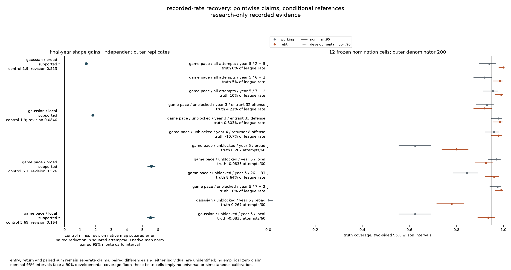
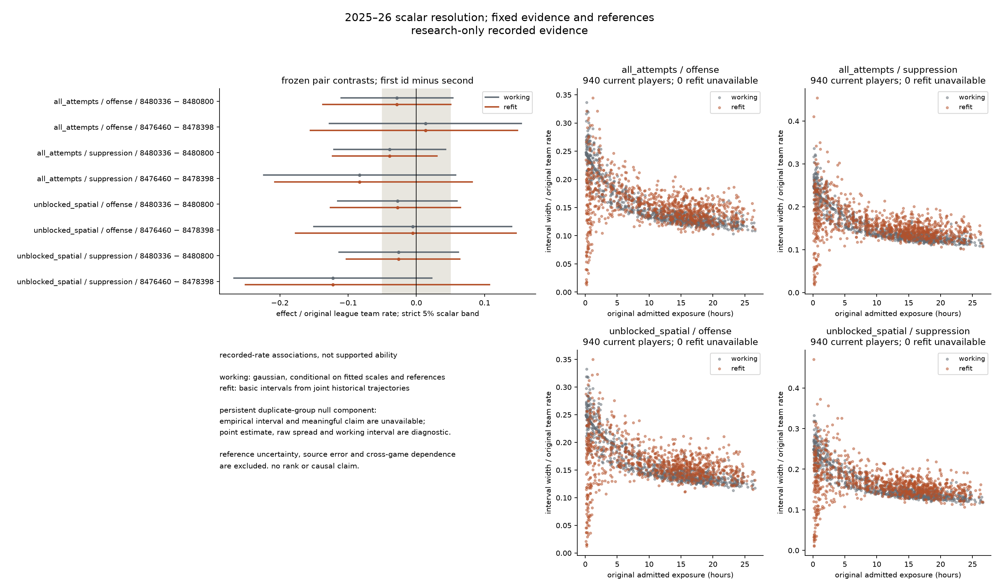
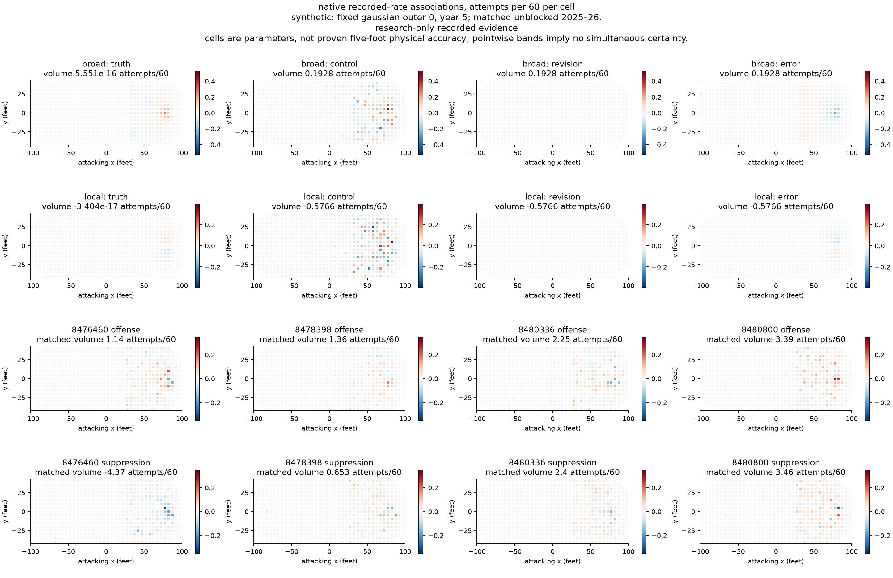

# 04b attribution revision

status: complete. the full frozen budget and corrected assessment are independently verified. [the plan](../../plan.md) owns progression; the [result](result.json) binds the exact evidence.

separate shape borrowing reduces native map error in all four fixed final-year comparisons. it does not establish usable native uncertainty: broad-shape peak coverage fails the developmental floor in both noise cases; local-shape coverage remains inconclusive. the frozen game-pace volume cells and final paired sum pass their criteria, while annual transitions remain inconclusive. the 24 frozen rules yield 19 supported, three inconclusive and two failed results. the recovery recommendation is `mixed`, not blanket model nomination. `admission:not_admitted,handoff:null`.

## recovery and scope

the frozen [protocol](protocol.md) executed 200 independent outer replicates in each noise case, with 200 full historical game refits inside every replicate: 400 outer replicates, 80,000 inner histories and 1,200,000 inner annual block fits. no draw failed or was replaced. the [independent statistical review](/Volumes/Expansion/hockey-stats/runs/attribution-04b-20261015/reviews/recovery-statistical-review.json) reconciles every outer artifact, block status, exact truth, interval, false-claim count and nomination rule. [verification](verification.md) owns numerical and software evidence.

| frozen claim group | result | scope |
|---|---|---|
| broad native shape | failed | error improves, but both final peak-cell coverage floors fail |
| localized native shape | inconclusive | error improves; both final peak-cell coverage intervals overlap the floor |
| volume | supported | the four frozen final-year game-pace scalar cells only |
| annual transition | inconclusive | the three frozen game-pace spatial-volume cells: entrant 32 coverage overlaps the floor; entrant 33 and returner 8 pass |
| paired sum | supported | final-year game-pace spatial `26+31` only |

the four paired reductions compare revised and shared-volume control integrated squared native map error on identical responses. their intervals resample independent outer replicates, not correlated cells. positive values favor the revision; units are (attempts per 60 team minutes)² summed over native cells.

| noise / shape | mean reduction | paired 95% monte carlo interval |
|---|---:|---:|
| gaussian / broad | 1.3888 | [1.3245, 1.4550] |
| gaussian / localized | 1.8197 | [1.7571, 1.8818] |
| game pace / broad | 5.5745 | [5.3469, 5.8103] |
| game pace / localized | 5.5219 | [5.3077, 5.7453] |

the primary intervals are pointwise 95% basic game-refit intervals. the developmental criterion asks whether a 95% wilson interval for their coverage lies entirely at or above .90. passing that floor does not certify 95% calibration. each denominator below is 200 independent outer replicates for one named contrast, year and functional.

| nomination coverage cell | covered / 200 | wilson 95% interval | result |
|---|---:|---:|---|
| gaussian broad, final native cell 591 | 156 | [.718, .832] | failed |
| game pace broad, final native cell 591 | 160 | [.739, .850] | failed |
| gaussian localized, final native cell 607 | 187 | [.892, .962] | inconclusive |
| game pace localized, final native cell 607 | 185 | [.880, .954] | inconclusive |
| game pace entrant 32 offense, spatial volume, entry year 3 | 184 | [.874, .950] | inconclusive |
| game pace entrant 33 defense, spatial volume, entry year 3 | 197 | [.957, .995] | supported |
| game pace returner 8 offense, spatial volume, return year 4 | 196 | [.950, .992] | supported |
| game pace all attempts, final `2−5` | 200 | [.981, 1.000] | supported |
| game pace all attempts, final `6−2` | 197 | [.957, .995] | supported |
| game pace all attempts, final `7−2` | 198 | [.964, .997] | supported |
| game pace spatial volume, final `7−2` | 198 | [.964, .997] | supported |
| game pace spatial volume, final `26+31` | 192 | [.923, .980] | supported |

all eight frozen scalar false-claim criteria pass the developmental ceiling: their union counts are `0,2,0` for all-attempt pairs `2−5,6−2,7−2`; `1,3,0` for spatial entrant 32, entrant 33 and returner 8; and `0,0` for final spatial `7−2,26+31`. the largest wilson upper bound is `.0432`, below `.10`. the denominator stays 200 even when the interval makes no assertion. exact rational truths retain the strict 5% boundary: the one meaningful-positive assertion for true 5% `6−2` is an error.

low false-claim rates come with limited resolution. in game pace, the true-zero all-attempt pair receives no near-zero label in 200 replicates; the true-5% pair excludes zero in 10/200, comprising nine positive and one incorrect negative assertion; the true-10% pair receives meaningful-positive separation in 10/200 all-attempt and 4/200 spatial replicates. mean refit widths for these pairs are about 28–32% of their league rates, wider than the entire 10% meaningful band. recovery and usefulness are different questions.

the full [recovery artifact](/Volumes/Expansion/hockey-stats/runs/attribution-04b-20261015/simulation/simulation.json) retains all 136 named coverage cells, all scalar false-claim components, first/final native and regional errors, working/control intervals and descriptive all-player results. among the 88 data-identified refit coverage cells, 40 support the floor, 28 fail and 20 remain inconclusive. the other 48 cells are unidentified diagnostics, not coverage successes. the 26 failures outside nomination comprise 20 of the 24 broad regional cells, both first-year broad peak cells, and four gaussian scalar cells. gaussian first-year paired-sum coverage is 122/200 all-attempt and 100/200 spatial; gaussian returner coverage is 150/200 all-attempt and 137/200 spatial. the remaining four broad regional cells are inconclusive. the narrow supported groups above cannot be read as universal scalar, temporal or regional calibration.

this figure is entirely synthetic gaussian/game-pace recovery, despite its generic recorded-evidence subtitle. broad/local coverage in the right panel refers only to peak cells 591/607. the footer's unidentified difference and individuals are specifically `26−31`, player 26 and player 31; it does not declare the other pairs unidentified.

## exact nulls and conditional uncertainty

players 26 and 31 share persistent same-role deployment. all 9,600 assessed individual/difference rows suppress empirical intervals and directional or equivalence assertions; their saved raw spread and working intervals remain prior-conditioned diagnostics. the sum is assessed separately. more game refits cannot identify an exact likelihood-null difference.

30,587 inner block fits retain an own or inherited scale limitation (`2.549%` of 1,200,000); 18,352 carry an inherited limitation, included in that total. every finite state remains in its denominator. recovery fixes the known generating rates `r_U=40,r_all=55`, synthetic design exposure `u` and corrected real first-season native shares `p`. real refits separately fix the original annual `r,u` and the same `p`; observed topology, age-neutral history and admitted source coverage stay conditional. game refits vary the fitted chains and their selected scales; they do not estimate total ability uncertainty, source error, reference uncertainty, unseen-player behavior or cross-game dependence. improved map error does not establish valid uncertainty.

## real historical refits and resolution

all 200 assigned real trajectories completed, with all 15,084 requested projections retaining 200 finite values. the independent review reconciles all 1,000 normalized inventory-weight arrays and 3,000 annual block searches. every real weighted search resolves within the frozen bounds. the point fit is different: first-year shape entry selects `1e-8`, and all five point shape states retain that own or inherited limitation. resolved weighted searches and bounded numerical movement do not remove it.

all ten original scalar/volume controls reproduce: all-attempt arrays exactly, spatial-volume arrays with maximum relative array error below `4.94e-16`. first/final conditional shape checks pass; the largest current-player regional movement is `1.23e-8` of the league rate against the fixed `1e-4` numerical threshold, with no working-label changes. this check holds incoming priors fixed; it does not bound propagated history or statistical coverage.

the final season contains 940 current players in each population. all current-player scalar/region intervals are available; no exact persistent same-role duplicate group is found in the real prefixes. that narrow check does not establish general identification or rule out near-confounding. observed counts/exposure, point associations and interval labels remain distinct.

the table uses the specified strict scalar band and pointwise basic game-refit intervals. each row includes all 940 current players, with no exposure cutoff. positive suppression means fewer opponent attempts.

| population / role | meaningful positive | meaningful negative | within band | unresolved | median interval width / league rate |
|---|---:|---:|---:|---:|---:|
| all attempts / offense | 18 | 17 | 28 | 877 | 15.08% |
| all attempts / suppression | 4 | 11 | 25 | 900 | 15.27% |
| unblocked spatial / offense | 14 | 15 | 31 | 880 | 15.92% |
| unblocked spatial / suppression | 2 | 6 | 26 | 906 | 16.06% |

3,563/3,760 individual scalar contrasts remain unresolved (`94.76%`); all eight frozen pair/population/role comparisons remain unresolved. the 110 within-band labels are conditional outputs of this procedure, not established ability equivalence. reference uncertainty, source error and cross-game dependence remain excluded. working intervals are retained separately; their median widths are `13.82%` for all attempts and `14.86%` for spatial volume. no variance is added to the refit distribution.

the resolution figure uses the same outcome-blind pairs `(8476460,8478398)` and `(8480336,8480800)`, first id minus second, with original annual exposure for every current player. exposure/width association is descriptive; no ranking, minimum-time eligibility rule or causal claim follows.

## native complete-rate behavior

the same five-year ledgers and original source exclusions remain. six negative complete all-attempt rows remain, minimum `−5.28605` attempts/60; two negative spatial-total rows remain, minimum `−1.96532`. the revised minimum native cell rate is `−1.12736`, compared with the unchanged control's `−2.03887` attempts/60. supported positive-duration zero-event rows remain in every denominator; predictions are never clipped.

negative-cell frequency weights all row×656-cell predictions by admitted directional seconds. negative mass instead divides the exposure-weighted sum of negative rate magnitudes by the original league rate times the same exposure. both are shown as percentages below; neither estimates the fraction of observed attempts that is negative.

| season | negative-cell frequency, revision / control | negative mass, revision / control |
|---|---:|---:|
| 2021–22 | 27.4542% / 52.6400% | 0.2725% / 19.4897% |
| 2022–23 | 41.3514% / 49.4865% | 1.4298% / 19.9281% |
| 2023–24 | 44.7711% / 47.7496% | 4.6250% / 20.4846% |
| 2024–25 | 45.1383% / 46.8799% | 7.7601% / 20.3119% |
| 2025–26 | 44.9070% / 46.8783% | 9.2670% / 20.1956% |

separate borrowing reduces these negative predictions but leaves the additive family unconstrained. signed player contrasts remain legitimate; complete negative rates prevent an event-intensity interpretation. [complete-rate adequacy](../../issues/attribution-negative-rates.md) remains open separately from [uncertainty](../../issues/attribution-working-uncertainty.md).

the native-map figure uses gaussian outer zero, year five as its fixed synthetic illustration and all four frozen real examples in both roles. synthetic truth matched volumes are exactly zero; printed map sums of `5.55e-16` and `−3.40e-17` attempts/60 are accumulation roundoff. truth, control, revision and errors share scales within each comparison; the eight real maps share one scale. native cells remain parameters, with no established five-foot physical accuracy or simultaneous map certainty.

## reporting repair

the first assessment exposed a strict-sign control bug: splitting and recombining the old maps introduced tiny negative values in originally exact-zero columns. the named read-only control now retains original `M,A` and their original complete-rate arithmetic. three complete original games reproduce exact original counts, frequencies, extrema and negative mass after the repair; no tolerance, clipping or fallback is used. the original `assessment/` remains preserved with invalid control sign diagnostics. fits, refit projections and recovery remain unchanged.

the model protocol stays frozen at `d465795`; corrected `assessment-02/` records its own clean reporting producer `d3ef9b5` and the unchanged `model_implementation`. independent source review reproduces all seven original control diagnostics exactly across all ten annual states. only the five spatial control summaries change; revised diagnostics, projections, recovery and scientific decisions remain unchanged. projections and all three figures are byte-identical. the [correction receipt](/Volumes/Expansion/hockey-stats/runs/attribution-04b-20261015/receipts/reporting-correction.json) binds both reporting passes, unchanged outputs and final reviews. no fit, draw, scale search or threshold was repeated.

## cost and tradeoffs

| command / stage | measured wall time | peak resident memory, bytes |
|---|---:|---:|
| preparation procedure | 218.14 seconds | 599,703,552 |
| point-fit procedure | 189.02 seconds | 2,167,881,728 |
| seven real refit range procedures | 24.8729 summed process hours; longest concurrent range 4.1804 hours | 3,247,030,272 maximum per process |
| nested recovery command | 1,673.51 seconds | 1,286,619,136 parent process only |
| original assessment command | 330.77 seconds | 6,286,295,040 |
| corrected assessment command | 299.98 seconds | 6,298,124,288 |

concurrent durations are not summed elapsed time, and memory maxima are not aggregate worker memory. both reporting passes cost 630.75 command seconds; the structured result's assessment snapshot describes only the corrected pass. the first real trajectory projected 10.61 process hours; contention increased observed concurrent draw latency to 523–566 seconds and actual summed range cost to 24.8729 hours. the original estimate remains preserved. expensive fits/projections remain external-only; accepted manual rerun risk is unchanged.

full native shape preserves localized signals and noise without smoothing; separate borrowing adds one scale process and covariance state. the additive family still permits negative complete rates. historical game refits pay substantial computation for fitting/scale/history variation while holding reference rates, centering, native shares, topology and source coverage conditional. exact-null protection withholds individual claims rather than supplying an identification theorem. unchanged selective spatial coverage, context design and age-neutral history limit generalization. these costs are explicit parts of the selected experiment, not evidence for supported ability.

the study answers its question within the frozen budget: shape gains coexist with failed broad uncertainty, inconclusive local/transition recovery and mostly unresolved real contrasts. the uncertainty and complete-rate issues remain open. no follow-on fit, chance admission, publication or website handoff is assigned.
