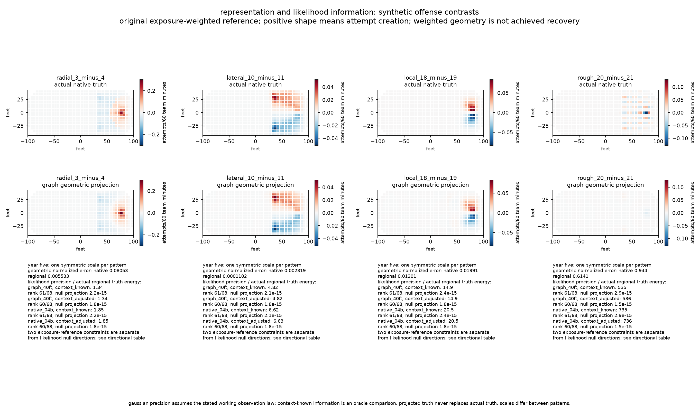
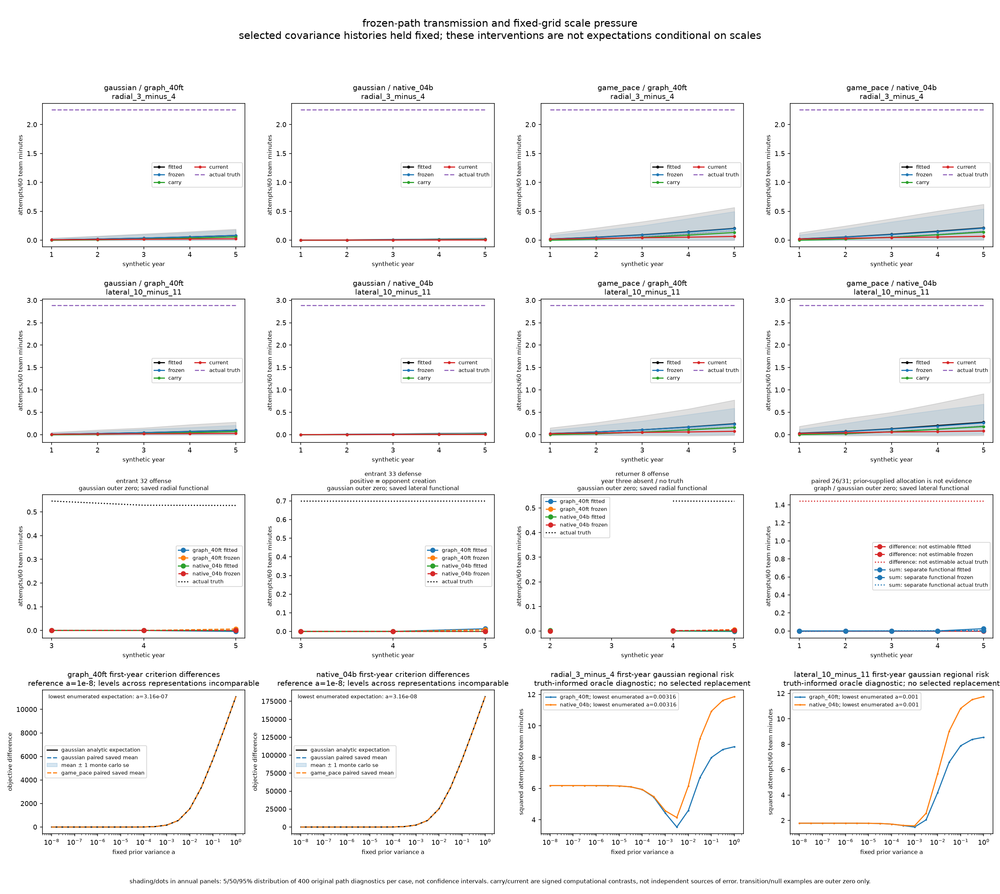

# 04d attribution diagnosis

status: **complete; known-truth diagnosis only.** all 800 histories and 8,000 annual states reconcile. [result](result.json) · [protocol](protocol.json) · [verification](verification.md). `nomination:null,admission:not_admitted,handoff:null`. [04c's verdict](../attribution-04c/decision.md) remains `mean_recovery_failed`.

the broad patterns are representable and identifiable, but noisy under the working observation law and strongly suppressed along the selected covariance paths. these mechanisms coexist. annual carry supports the two broad targets in these frozen paths; the evidence does not support blaming historical borrowing generally.

## what the evidence establishes

**representation:** graph projection has regional normalized squared error `0.005533` for radial and `0.000110` for lateral truth. fifth-year local and rough stresses have `0.012014` and `0.614145`; the rough native error is `0.943992`. broad geometric omission is small relative to fitted error, while the rough stress exposes a substantial representation limit. projection never replaces actual truth.

**information:** both primary contrasts are estimable in every annual design. fifth-year gaussian likelihood-only regional variance divided by actual truth energy is `1.344841/4.822316` for graph radial/lateral and `1.848018/6.626605` for native. knowing context barely changes these particular variances. this is substantial finite precision cost, without a newly invented adequacy threshold. the paired difference remains nonestimable; the paired sum is separately estimable. neither a prior allocation nor the sum identifies the individuals. year three supplies no returner truth.

**transmission:** fifth-year regional truth alignment, averaged over each case's original 400 paths:

| noise / representation | fitted radial / lateral | frozen radial / lateral |
|---|---:|---:|
| gaussian / graph | `0.034835 / 0.035060` | `0.035744 / 0.034100` |
| gaussian / native | `0.007410 / 0.007652` | `0.007611 / 0.007529` |
| game pace / graph | `0.088433 / 0.083693` | `0.086417 / 0.082424` |
| game pace / native | `0.095246 / 0.097969` | `0.092872 / 0.091963` |

alignment is a signed diagnostic, not a fraction recovered. gaussian graph normalized regional errors remain `0.932677/0.933728`; zero prediction has error one. for the fifth-year gaussian graph radial functional, signed carry `0.057617` plus current information `0.025340` gives frozen `0.082957`, against actual truth `2.254487` attempts/60 team minutes. all primary mean carry terms in years two through five are positive. carry helps these targets, but transmits an already attenuated history. actual-incoming one-step values and actual-minus-frozen remainders remain separate in the outputs. incoming coefficients retain their preceding reference until the annual update; individual/sum discrepancies can include recentering.

**scale pressure:** among the unchanged 17 first-year points, the expected gaussian global criterion is lowest at `3.162278e-7` for graph and `3.162278e-8` for native. the lowest enumerated primary oracle risks occur at `0.003162278` radial and `0.001` lateral. even these truth-informed normalized risks remain `0.571366/0.830897` for graph and `0.669437/0.885024` for native. global pooling and the sparse contrast targets favor different parts of the existing grid; this does not prove an inappropriate prior or select a replacement. paired empirical gaussian differences and monte carlo standard errors are reported throughout the grid, without an equivalence test.

## one next question

does the global shared-scale objective sacrifice broad primary contrasts through pooling, and would that tradeoff persist across prospectively chosen independent patterns?

the discriminating check would declare a practical prediction-cost budget and an independent synthetic broad-pattern population before comparing global objective pressure with contrast risk. contrary evidence matters: global prediction may rationally sacrifice these sparse targets, and their likelihood precision is limited even with a known gaussian law. this question is a recommendation, not an assigned experiment or penalty choice.

frozen-path interventions hold response-dependent covariance histories fixed; they are not expectations conditional on selected scales. game-pace sampling precision and its comparative failure remain unresolved. real-player identification, adaptive-selection uncertainty, unconditional temporal risk, conditional reference shares and additive-rate limits remain outside this diagnosis.

