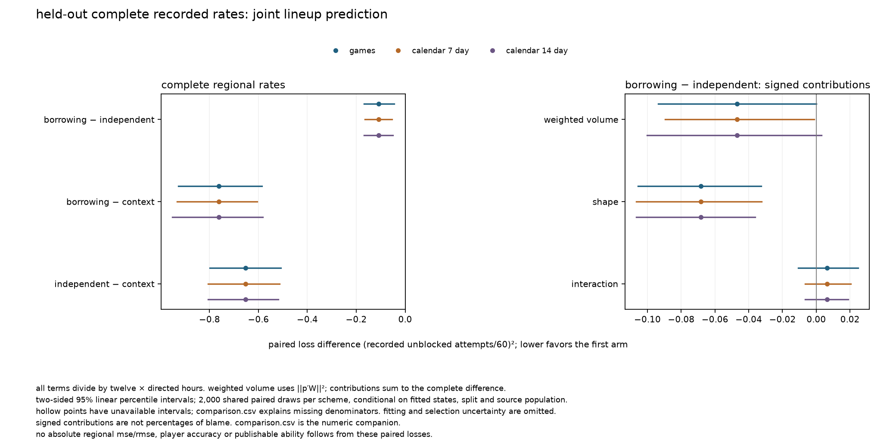

# complete recorded-rate adequacy

**does annual borrowing improve held-out complete regional unblocked-attempt rates, and where do volume, shape or composition fail?**

purpose: `research`; numerics: `verified`; admission: `not_admitted`.

this is recorded joint lineup prediction on matched genuine-5v5 spatial support, including zero-event exposure. it is not separate offensive/defensive ability, all-attempt opportunity value or a forecast available before the games. all seasons remain research-exposed.

## complete-rate evidence

| contrast | games estimate | games 95% interval | direction across three schemes |
|---|---:|---|---|
| borrowing − independent | -0.108809 | [-0.1688306, -0.04448516] | `supported_lower_loss` |
| borrowing − context | -0.7618389 | [-0.9269467, -0.5858658] | `supported_lower_loss` |
| independent − context | -0.6530299 | [-0.7989797, -0.5088556] | `supported_lower_loss` |

## native complete-rate evidence

| contrast | inverse-share estimate | games 95% interval | direction across three schemes |
|---|---:|---|---|
| borrowing − independent | 2.771051 | [-10.01179, 15.29088] | `unresolved` |
| borrowing − context | -63.17128 | [-85.63487, -39.87344] | `supported_lower_loss` |
| independent − context | -65.94233 | [-83.236, -48.35613] | `supported_lower_loss` |

native inverse-share complete loss divides by directed hours; its volume weight is one and its interaction is zero.

negative paired differences mean lower error. regional aggregate units are `(recorded unblocked attempts/60)^2`, dividing the pooled numerator by twelve × directed hours. all three valid 95% intervals must lie below zero for `supported_lower_loss`, or above zero for `supported_higher_loss`; otherwise the direction is `unresolved`. no gain threshold or admission gate is introduced.

coverage: 1051 training and 261 assessment games; 1682.973 training directed hours and 421.4483 assessment directed hours; 17331 retained assessment attempts. 0 zero-time assessment games remain sampling/calendar units.

## source correction

the accepted correction removes 6 directed zero-count rows: 132 physical / 264 directed seconds, with count loss 0. original source evidence and grouped archives remain bound. count moments and scalar response energy are preserved only after checking the excluded rows are zero-count. exposure, league rate, residualization and training references are recomputed; nine new states and three exact reuses are selected.

frozen correction games: `2023020041`, `2023020685`, `2024020186`.

the correction changes borrowing volume and shape history; source-only sensitivity below isolates the borrowing-shape consequence.

## volume, shape and interaction

| borrowing − independent component | estimate | games 95% interval |
|---|---:|---|
| weighted volume | -0.04701993 | [-0.09357125, -2.036006e-05] |
| shape | -0.06822569 | [-0.1055659, -0.03270796] |
| interaction | 0.006436607 | [-0.01066613, 0.02476172] |

standalone volume difference: -4.033639; games interval [-8.027079, -0.001746603]; `unresolved` across three schemes, divided by directed hours. the regional volume contribution weights its numerator by `||p′W||²`; all three contributions share twelve × hours. interaction is a signed cross residual computed directly from grouped moments. contributions are not percentages of blame. inverse-share native error has unit volume weight and zero interaction. paired moments do not establish absolute regional mse/rmse.

## physical-rate limitations

| arm | resolution | strict negative entries | exposure-weighted entry fraction | any-negative-row exposure fraction | negative mass (predicted attempts) | minimum rate |
|---|---|---:|---:|---:|---:|---:|
| borrowing | total | 0 | 0 | 0 | 0 | 6.414351 |
| borrowing | regional | 4586 | 0.002273246 | 0.02656975 | 0.8977247 | -1.870433 |
| borrowing | native | 34517895 | 0.2977604 | 1 | 278.7205 | -0.5094677 |
| independent | total | 0 | 0 | 0 | 0 | 10.53561 |
| independent | regional | 2383 | 0.001178091 | 0.013826 | 0.2970965 | -0.6177655 |
| independent | native | 34560488 | 0.2984678 | 1 | 190.1001 | -0.4185049 |
| context | total | 0 | 0 | 0 | 0 | 33.22521 |
| context | regional | 0 | 0 | 0 | 0 | 0 |
| context | native | 0 | 0 | 0 | 0 | 0 |

strict signs use `prediction < 0`, separate from numerical closure tolerances. entry fractions divide exposure-weighted negative entries by location count × directed exposure; any-negative-row fractions count each row once. negative mass integrates exposure × negative predicted rate, with a common dimensionless reference `training_r × assessment_directed_hours`. total, twelve-region and native resolutions retain their own denominators and exact worst-row/location locators in rate-diagnostics.csv. historical negative-total-rate meaning is retained separately from any-negative-entry exposure. signed effects may be negative; a negative complete prediction cannot be interpreted as an event intensity. no clipping or zero-negative-cell pass gate is applied. regional adequacy is primary; native shortcomings remain visible.

## shape-only source sensitivity

corrected minus original borrowing shape: 3.313816e-07; games interval [-5.486877e-06, 5.483059e-06]; `unresolved` across all schemes. this compares corrected and frozen original final borrowing shape on unchanged held-out games. it does not estimate the complete-rate consequence of correcting volume.

## conditional uncertainty and numerical scope

2,000 shared PCG64(404130) draws each for games, seven-day blocks and fourteen-day blocks pool numerators and float exposure. empty calendar blocks, zero-time games and undefined zero-denominator draws are retained; unavailable intervals carry reasons. an interval is unavailable if any draw has zero exposure, including draws of zero-time games or empty calendar blocks. these intervals condition on fitted models, selection, split and source population. there is no refitting, scheme selection or multiplicity control. month and support residual associations are descriptive diagnostics, not subgroup accuracy claims.

all 16 final component combinations and 4 source-only combinations were rescored on shared draws. complete-regional direction stability: `true`; source-only shape stability: `true`. each bounded probe conditions on incoming primary history; no propagated probe histories or further fitting is implied. finite endpoint winners and inherited unresolved scale flags remain limitations in the saved receipts.

selected primary scale statuses: `resolved`: 12. exact endpoint reasons and inherited flags remain in the numerical summary; bounded-probe verification does not resolve scale identification.

useful joint prediction does not resolve latent recovery, richer context, empirical player uncertainty or supported chance valuation. publication remains separate.

unresolved: this diagnostic study does not uniquely identify the next model revision.

comparison.csv supplies all twelve individual-region differences, native inverse-share diagnostics and intervals.
