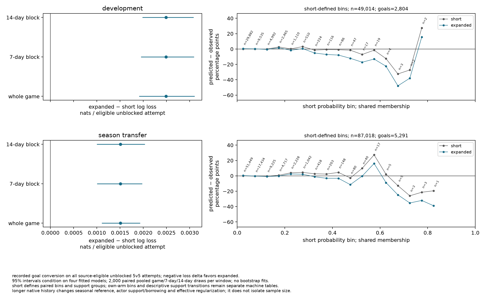

# 03n decision

status: `complete,short_direction,supported_horizon,short,not_admitted`. the four fresh fits and full-population paired assessments completed under the unchanged [protocol](protocol.md). [verification](verification.md) separates software acceptance from research evidence; [result.json](result.json) preserves full precision and bound external artifacts.

adding the complete 2021–22/2022–23 seasons worsens the current native estimator's later recorded-goal predictions in both windows. the frozen symmetric rule nominates **short** history. this nomination does not adopt a horizon, admit a model or authorize another fit.

## populations

| window | short training: games; applicable / goals | expanded training: games; applicable / goals | common assessment: games; applicable / goals |
|---|---|---|---|
| development | 1,912; 128,679 / 7,614 | 4,536; 306,041 / 18,471 | 712; 49,014 / 2,804 |
| season transfer | 2,624; 177,693 / 10,418 | 5,248; 355,055 / 21,275 | 1,312; 87,018 / 5,291 |

all source-eligible unblocked attempts enter; no feature omissions or sequence filter. assessment streams retain all 85,317 / 153,754 recognized rows in source order, with native excluded/not-applicable dispositions. the five distinct seasons contain 6,560 games, 442,073 applicable attempts / 26,566 goals and 2,601 unavailable recognized rows. windows overlap in training; development assessment subsequently enters transfer training. they are chronological research-exposed checks, not independent confirmation.

## losses and calibration

| window / horizon | mean log loss, nats/attempt | brier | predicted goals | observed goals | pooled predicted − observed, pp |
|---|---|---|---|---|---|
| development / short | 0.1893679925500723 | 0.04983799959994468 | 2906.2511427895947 | 2804 | 0.20861619698370817 |
| development / expanded | 0.1918583360559353 | 0.05040980295798729 | 2911.838600455909 | 2804 | 0.22001591475070148 |
| season_transfer / short | 0.19971918681969086 | 0.05323488632430173 | 5368.619895086293 | 5291 | 0.08919981507997503 |
| season_transfer / expanded | 0.20122839932753073 | 0.053505541608753614 | 5390.374054147522 | 5291 | 0.1141994232773929 |

primary differences are **expanded minus short**, using pooled stable native log losses. negative favors expanded; positive favors short. paired differences use per-game sums; subtracting separately accumulated mean losses can differ in the last floating-point digits.

| window | paired delta, nats/attempt | whole-game 95% interval | seven-day 95% interval | fourteen-day 95% interval |
|---|---|---|---|---|
| development | 0.0024903435058618952 | [0.0019069177114283374, 0.0031066638404736737] | [0.0019484643853192065, 0.0030895006333460087] | [0.0019811640952823433, 0.0030815796762335285] |
| season_transfer | 0.0015092125078409676 | [0.001106950765255123, 0.001930391236696731] | [0.0010035731019243342, 0.001975917294789771] | [0.000997467007364485, 0.0020320631449148203] |

relative mean-loss changes are `0.013150815363918501` development and `0.00755667260553942` transfer: about 1.315% and 0.756% worsening. every primary interval lies above the fixed `1e-10` arithmetic deadband. all methods are defined; neither calendar method opposes short. these facts satisfy the declared nomination, without a new useful-effect threshold.

| window / secondary difference | paired estimate | whole-game 95% interval | seven-day 95% interval | fourteen-day 95% interval |
|---|---|---|---|---|
| development / brier | 0.0005718033580422473 | [0.00042892251209091783, 0.000726186375838576] | [0.0004133503160524377, 0.0007287371385867069] | [0.0004046783322938282, 0.0007421499148717348] |
| development / signed pooled residual, pp | 0.01139971776695798 | [-0.012103641514908238, 0.03316602082733249] | [-0.018956412895091028, 0.03732853895533739] | [-0.018550063955546942, 0.03608046657641846] |
| season_transfer / brier | 0.00027065528445175015 | [0.0001771528747975262, 0.00036362002201443866] | [0.00016200609115438286, 0.0003687550537901544] | [0.00016159640973518764, 0.0003797907643083377] |
| season_transfer / signed pooled residual, pp | 0.02499960819743703 | [0.009994371219696405, 0.03967641778507335] | [0.008134155173511133, 0.042183786499957986] | [0.009104438562376032, 0.04410244008777003] |

brier worsens in both windows under every interval method. absolute pooled residual increases by `0.011399717766993306` / `0.024999608197417866` pp. development signed-residual intervals cross zero; transfer intervals are positive. these secondaries do not establish calibration support for short, explain the loss difference or reopen historical admission gates.

each window uses 2,000 paired whole-game draws and 2,000 each seven-/fourteen-calendar-day draws, `PCG64`, seed `3032026`, linear 95% percentiles. all games contribute: 712 / 1,312. development retains 16 seven-day blocks (15 contributing) and eight fourteen-day blocks (eight); transfer retains 28 (26) and fourteen (thirteen). empty blocks and final partial blocks remain. zero undefined draws; 12,000 total draws, ZERO bootstrap fits. intervals condition on these four fitted models and omit fitting, selection and source uncertainty.

the figure shares column axes across windows, marks zero and labels nonempty short-defined bin counts. all twenty paired bins retain identical membership between arms; own-arm bins remain separate machine tables. six fixed group partitions and all nine support transitions are descriptive. sparse high-probability bins are visibly noisy; they do not create new gates or subgroup nominations.

pooled benefit is not universal across groups. no-recent context favors expanded in development / transfer: paired log-loss changes `-0.0003779177067919359` / `-0.00027925457717559166` nats/attempt. slap favors expanded in both windows; the short-defined unseen-shooter transfer group also favors expanded (`-0.0006689865047772581`). these descriptive points have no subgroup intervals or nomination gates.

## support and interpretation

| short → expanded support | development shooter: attempts / goals | development goalie | transfer shooter | transfer goalie |
|---|---|---|---|---|
| `observed_in_state` → `observed_in_state` | 47,165 / 2,731 | 48,249 / 2,744 | 81,689 / 5,001 | 82,635 / 5,015 |
| `other_seasons_only` → `other_seasons_only` | 1,006 / 35 | 510 / 37 | 631 / 35 | 1,582 / 103 |
| `unseen` → `other_seasons_only` | 190 / 8 | 0 / 0 | 383 / 16 | 2 / 0 |
| `unseen` → `unseen` | 653 / 30 | 255 / 23 | 4,315 / 239 | 2,799 / 173 |

the other five transitions have zero attempts/goals in every actor/window. expanded history newly supplies penalty-inferred older support on 190 / 383 shooter attempts and zero / two goalie attempts; it changes fitted states/maps for recurring actors as well. shared 2023–24/2024–25 training actor counts are identical. assessment `season_basis,state_season` agree across arms; transfer carries 2024–25 into 2025–26. an older-only state is not an observed 2024–25 state; unseen residuals are zero. the native level/change penalties attenuate older-only states across terminal unobserved years rather than carrying old estimates unchanged.

this is a joint native estimator-horizon comparison. expanded history changes the earliest seasonal reference from 2023–24 to 2021–22, actor dimensions/borrowing and likelihood-to-penalty balance. geometry, type-by-cell maps and context terms remain shared across years. fixed penalty numbers do not hold effective shrinkage fixed. the result identifies neither an isolated sample-size effect nor which mechanism caused the worsening; it does not implement hockeyviz's annual-prior propagation.

recorded shot-type composition is a concrete drift channel: 03m model-type counts over all recognized rows give snap shares of wrist plus snap of 18.0%, 21.2%, 18.9%, 28.7% and 35.6% from 2021–22 through 2025–26. that denominator includes excluded/blocked rows; it is not the eligible-unblocked assessment population. added older labels enter pooled type maps scored on later composition. these observations cannot distinguish hockey changes from classification practice or prove why expanded lost. original labels stay; [the measurement issue](../../issues/recorded-shot-type-drift.md) remains open. source eligibility, coordinate limitations and unavailable observations are unchanged.

## numerical limits and next ownership

| window / horizon | coefficients | iterations | saved = replayed objective | replay maximum absolute gradient |
|---|---|---|---|---|
| development / short | 6159 | 461 | 24440.80386334864 | 0.11673671627710291 |
| development / expanded | 9737 | 589 | 60704.22988789599 | 0.7530455184992988 |
| season_transfer / short | 6335 | 479 | 33560.75691735772 | 0.2354199797576051 |
| season_transfer / expanded | 10025 | 659 | 69967.32750025298 | 0.307280293943748 |

all four native fits report `CONVERGENCE: RELATIVE REDUCTION OF F <= FACTR*EPSMCH`, with finite coefficients/objectives. each saved objective was replayed exactly once through shared setup, with exactly zero difference and exact rebuilt layout agreement. all gradients exceed `optimizer_gtol=1e-6`; relative-objective termination is permitted by the frozen rule. replay agreement verifies saved arithmetic, not optimality or a solver-error bound. the arithmetic deadband is neither optimizer uncertainty nor a practical-effect guarantee. no tighter solve, extra start or fifth fit followed the results.

short is conditionally nominated for review before choosing a horizon for queued [03o](../../specs/03o-outcome-decomposition.md). observable on-net × goal-given-on-net decomposition still needs a full specification and explicit assignment; mirror pooling remains an alternative. any direct control must match the eventual recipe, full-source population and numerical contract exactly. this study neither licenses reuse without that comparison nor launches a horizon-by-layer matrix. calibration, physical-origin meaning and supported player claims remain separate obligations. no horizon adoption, model admission, player/card claim, 04 handoff, publication or changed historical verdict follows.
