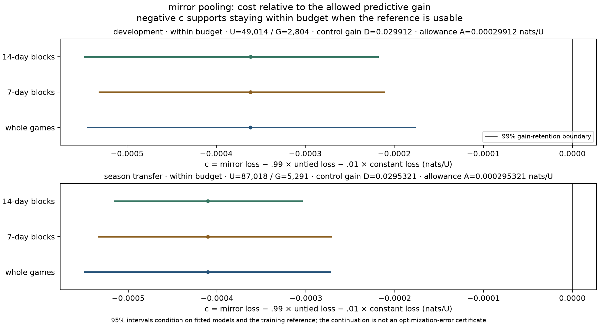
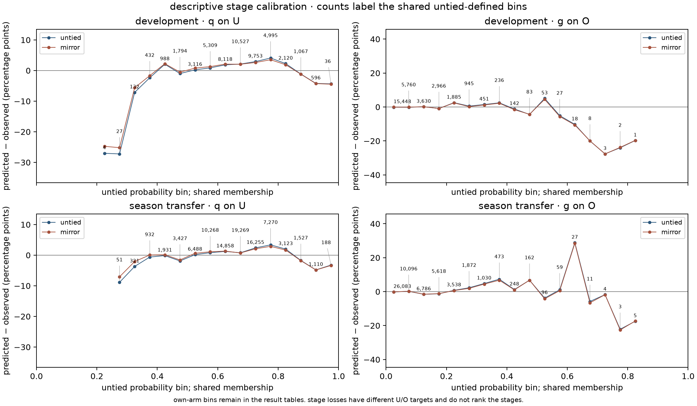

# 03p decision

mirror pooling meets the selected 99% predictive-gain retention policy in both windows and passes the bounded numerical check. nominate `mirror_y` for developmental use under this estimator and population. the result is `within_budget,nominate_mirror,mirror_y,not_admitted`; execution is complete. this does not admit a model, publish player ability or overturn 03o’s historical no-supported-representation verdict.

both arms already contain `q=p(on_net|unblocked,x)` and `g=p(goal|on_net,x)`. this experiment reduces independent spatial coefficients by sharing corresponding left/right cells within each type map. it leaves the two-stage interpretation intact. the observed goal-loss points improve slightly, but general superiority is not established: five of six raw mirror-minus-untied intervals cross zero. superiority was not required by the frozen practical-cost policy.

the [result](result.json) is byte-identical to the completed external report, sha256 `01edeefecb3358ebd53c88e548d06e22678f2f854916030f7ca2cd343f36cbc8`. [the protocol](protocol.md) fixes inputs, comparison and numerical rules before fitting; [verification](verification.md) records execution, independent reconciliation, costs and rendering provenance.

## populations and coefficient constraint

| window / partition | selected games | U | O | G |
|---|---:|---:|---:|---:|
| development training | 1,912 | 128,679 | 87,618 | 7,614 |
| development assessment | 712 | 49,014 | 31,658 | 2,804 |
| transfer training | 2,624 | 177,693 | 119,276 | 10,418 |
| transfer assessment | 1,312 | 87,018 | 56,111 | 5,291 |

`U` is source-eligible unblocked genuine-5v5 attempts, `O` recorded on-net attempts and `G` goals. q trains/scores on U; g trains/scores on O. both stages predict every U, including 17,356 development and 30,907 transfer misses; the product scores goals on U. original source labels, exclusions, ordered rows, actor support and zero-contribution games remain intact. development assesses the 2024–25 games from january onward; transfer assesses 2025–26 after training on 2023–24/2024–25. these chronological windows are research-exposed, and their training overlaps.

| independent coefficients | untied | mirror |
|---|---:|---:|
| six spatial maps per stage | 3,936 | 2,088 |
| development q, all terms | 6,159 | 4,311 |
| development g, all terms | 6,147 | 4,299 |
| transfer q, all terms | 6,335 | 4,487 |
| transfer g, all terms | 6,317 | 4,469 |

656 native cells form 348 reflection orbits: 40 centreline cells and 308 pairs. each stage removes 1,848 free spatial coefficients, about 47% of the spatial coefficients. intercept, season, actor and circumstance terms remain untied and are refitted. the restricted existing objective preserves the original likelihood and penalty weights, including doubled reflected-edge contributions. expanded prediction arrays and nearest-cell tie behavior remain native. these are parameter counts, not effective degrees of freedom, storage savings or proof of reflection equality for every raw coordinate or complete prediction.

## selected predictive-cost comparison

the constant forecast is fixed at training G/U. let `D=L_constant−L_untied`, `A=.01*D`, `delta=L_mirror−L_untied`, and `c=delta−A`. losses and contrasts below are nats per U. negative c means the mirror is inside the selected cost allowance. 99% concerns predictive gain over that constant, not accuracy or calibration.

| window | constant loss | untied loss | mirror loss | control gain D | allowance A | delta | c |
|---|---:|---:|---:|---:|---:|---:|---:|
| development | 0.219250457433 | 0.189338469328 | 0.189276040620 | 0.029911988105 | 0.000299119881 | -0.000062428708 | -0.000361548589 |
| season_transfer | 0.229215055318 | 0.199682959818 | 0.199567980314 | 0.029532095501 | 0.000295320955 | -0.000114979503 | -0.000410300458 |

| window / resampling unit | 95% interval for c | 95% interval for D |
|---|---:|---:|
| development / games | [-0.000544502105, -0.000177048205] | [0.027754663881, 0.032208487616] |
| development / calendar_7_day | [-0.000531483207, -0.000211453811] | [0.027280010503, 0.032716866663] |
| development / calendar_14_day | [-0.000547812404, -0.000218570029] | [0.026761561669, 0.033186559008] |
| season_transfer / games | [-0.000549082906, -0.000272801156] | [0.027944002872, 0.031247896296] |
| season_transfer / calendar_7_day | [-0.000533737802, -0.000271596933] | [0.027312189951, 0.031695968752] |
| season_transfer / calendar_14_day | [-0.000515518400, -0.000304260239] | [0.027315689063, 0.031866628060] |

all six c upper bounds and both c points are below zero. all six D lower bounds and both D points are positive; each reference is usable. both windows therefore classify `within_budget`. no draw was undefined. the three methods each use 2,000 whole-game or nonoverlapping calendar-block draws, retaining empty blocks and zero-contribution games. identical draws resample all three losses together, including the constant’s assessment loss.

these 95% intervals condition on the fitted models, fixed training reference and selected design. they omit fitting, source and selection uncertainty. agreement across three methods is the conservative selected policy, not six independent confirmations or a simultaneous confidence guarantee.

## numerical sensitivity

all eight prescribed continuations reached the 100-iteration cap with 108–113 evaluations. every endpoint was finite and had a lower training objective; all qualified as valid diagnostic states. cap termination is not convergence. originals remain the assessed models.

| window | B, separate absolute arm-loss movement | B / A | allowed B / A | largest absolute c interval shift | outcome |
|---|---:|---:|---:|---:|---|
| development | 1.1169786035e-05 | 3.734217% | 10% | 1.98894286241e-07 | `stable_within_probe` |
| season_transfer | 1.13720011803e-05 | 3.850726% | 10% | 1.29805871075e-07 | `stable_within_probe` |

all four original/probed arm combinations retain usable references and the same within-budget classification. c points and interval endpoints stay within the original numerical allowance. B prevents cancellation between arms from hiding movement. this establishes stability under the single specified continuation; it is not an optimization-error certificate or a bound on player effects. [verification](verification.md#bounded-numerical-outcomes) retains every original/endpoint objective, free gradient, probability movement, loss change and termination.

## contrary diagnostics and limits

the practical-loss nomination does not establish better calibration. development product brier worsens slightly, and product pooled overprediction increases in both windows. q still materially overpredicts recorded on-net. g’s small pooled residual conceals bin errors. stage losses have different targets and denominators, so their magnitudes do not rank the stages.

| window / quantity | denominator / observed positives | untied → mirror predicted positives | untied → mirror residual, pp | untied → mirror brier |
|---|---:|---:|---:|---:|
| development / q on U | 49,014 / 31,658 | 32559.530652 → 32560.981020 | +1.839333 → +1.842292 | 0.219902407 → 0.219701482 |
| development / g on O | 31,658 / 2,804 | 2815.629887 → 2816.395405 | +0.036736 → +0.039154 | 0.072696371 → 0.072728315 |
| development / product on U | 49,014 / 2,804 | 2870.732294 → 2872.709733 | +0.136149 → +0.140184 | 0.049803638 → 0.049807905 |
| season_transfer / q on U | 87,018 / 56,111 | 57062.776851 → 57058.336299 | +1.093770 → +1.088667 | 0.219464357 → 0.219172125 |
| season_transfer / g on O | 56,111 / 5,291 | 5257.750175 → 5260.174887 | -0.059257 → -0.054936 | 0.077749626 → 0.077692412 |
| season_transfer / product on U | 87,018 / 5,291 | 5322.590065 → 5324.195230 | +0.036303 → +0.038148 | 0.053215274 → 0.053184717 |

the figure uses common untied-defined membership and comparable axes within each stage column. its count-label placement was refined after scientific completion; [rendering provenance](verification.md#rendering-provenance) binds the unchanged result and separately rendered figures. all twenty own-arm bins, paired bins and fixed context/type/month/role/actor-support groups remain in the result. sparse tail bins retain their counts; no post-result subgroup gate or resampling campaign was added.

hard symmetry trades possible real left/right differences for stronger pooling. the existing penalty is restricted rather than retuned. expanded native arrays preserve the prediction contract without storage savings. exact control reuse depends on retained external evidence; real fits and diagnostic states remain external-only under the accepted manual-rerun policy. measured whole-command costs do not establish a controlled speed comparison.

recorded on-net and goal outcomes do not identify physical release locations, causal player ability or parity with private models. block contacts remain non-release observations. this unblocked structural comparison does not repair all-attempt/origin/spatial calibration, validate standardized opportunity or supply supported player weights. 03b/03e/03h/03o historical verdicts and research exposure remain unchanged.

03p is complete. no further fit, admission, attribution implementation or publication is assigned by this nomination. research-only 04a remains independent and unassigned; supported player outputs retain their separate evidence and release requirements.
